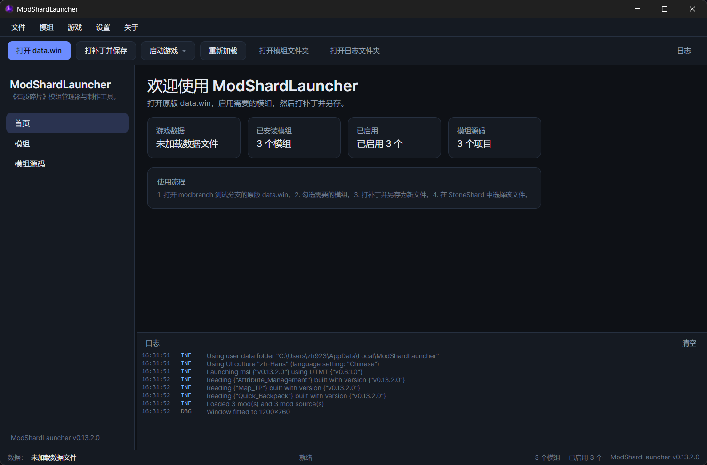

# ModShardLauncher（Avalonia 重构版）

《石质碎片》（Stoneshard）的**模组管理器**与**模组制作工具**。本仓库是从 WPF 版本重构而来的 .NET 10 项目，包含 **GUI（Avalonia）** 与 **CLI（无头）** 两个独立的可执行文件，共享同一个 Core 库。



## 功能

- 打开原版 `data.win`，扫描 `Mods/*.sml`，启用/禁用模组，打补丁并另存为新文件。
- 打补丁可以取消：GUI 忙碌遮罩上有「取消」按钮，CLI 按 Ctrl+C。流水线只在“mod 之间”和“写入目标文件之前”停下，因此取消不会留下半成品输出文件。
- 拒绝在已打补丁的文件上二次打补丁：检测到 `o_msl_timer` 会直接给出明确错误，而不是先重复注入日志钩子再报“事件已存在”。
- 打开数据文件时，选择器默认定位到 Steam 安装目录 `C:\Program Files (x86)\Steam\steamapps\common\Stoneshard`；该目录不存在时回退到当前工作目录。
- 保存时默认建议 `<原文件名>_patched.win`，并禁止覆盖当前已加载的原版 `data.win`。
- 在 `ModSources/` 中编译 C# 模组工程为 `.sml`（运行时 Roslyn，保留原有流程）。
- 完整保留 `Msl` modding API（命名空间、类型、方法签名不变）；程序集版本固定为 `1.0.0.0`，旧 `.sml` 通过独立 `AssemblyLoadContext` 按简单名绑定宿主 API，无需重新编译。
- 现代 IDE 风格界面：顶部菜单 + 工具栏 + 左侧导航 + 底部固定高度日志面板（实时显示补丁过程，不可拖拽调整）+ 状态栏。
- 中 / 英 / 俄三语，采用标准 `.resx` + satellite assemblies；默认跟随 Windows 显示语言，没有对应翻译时回退英文，可在设置中固定语言。
- 设置中可选“导出清单”（默认关闭）：开启后每次打开 `data.win` 会生成物品、武器、护甲 CSV；CLI 的 `export` 命令始终可用。
- 独立 CLI：批量打补丁、列出模组、编译模组、导出数据，便于 CI 和服务器使用。

## 解决方案结构

| 项目 | 程序集名 | 输出 | 说明 |
|---|---|---|---|
| `src/ModShardLauncher.Core` | `ModShardLauncher` | 库 | Modding API + 补丁/加载/纹理/编译等全部领域逻辑，**无任何 UI 依赖** |
| `src/ModShardLauncher.GUI` | `ModShardLauncher.GUI` | `ModShardLauncher.GUI.exe` | Avalonia 桌面客户端（MVVM） |
| `src/ModShardLauncher.CLI` | `ModShardLauncher.CLI` | `ModShardLauncher.CLI.exe` | 无头命令行工具 |
| `tests/ModShardLauncher.Tests` | `ModShardLauncher.Tests` | 测试 | xUnit 单元测试（跨平台） |

> **重要**：Core 的程序集名必须是 `ModShardLauncher`。已发布的 `.sml` 内部程序集引用了这个程序集名，改名会让所有历史模组失效。

详细设计与兼容性约定见 [`docs/architecture.md`](docs/architecture.md)；从头写一个模组见 [`docs/modding-guide.md`](docs/modding-guide.md)（含可编译示例、武器表/装备表写法与已知缺陷）。

## 兼容占位（保留，勿删）

脚本控制台已从本项目移除：打补丁不再注入 `o_ScriptEngine` / `SendMsg` / `give` / `msl_print` / `createHookObj`，GUI 不再有控制台窗口，CLI 也不再提供 `console` / MCP 命令。

但下面这些公开成员是**故意保留**的，仅用于让已发布的 `.sml` 继续加载；它们不会产生任何游戏内容、网络监听或控制台行为。后续清理代码时不要删除、改名或改签名：

| 成员 | 当前形态 | 约束 |
|---|---|---|
| `ModShardLauncher.Mods.ModInterfaceEngine`（`Instance`、`ModPath`、`CurrentCallbackID`、`IsLoadHooks`、`Variables`、`HookDelegates`、`Callbacks`、`Initalize`、`Execute`、`DoHook`、`AddHook`） | `[Obsolete]`；`Execute` 只写一条警告日志 | 旧 `.sml` 通过 `ldsfld` / `callvirt` 直接引用；删类型会 `TypeLoadException`，删成员会 `MissingMethodException` |
| `ModShardLauncher.Mods.EngineObject`、`ModShardLauncher.Mods.ModDelegate` | `[Obsolete]` | 上面类型的基类和字段类型，必须一起保留 |
| `Msl.HookFunction(string, string, params string[])` | `[Obsolete(..., error: true)]`，调用抛 `NotSupportedException` | 保留签名；不要改成静默 no-op（它依赖的注入 GML 已不存在） |
| `ModLoader.ScriptCallbacks` / `MslContext.ScriptCallbacks` | `public static` 字段 / 同名属性 | 旧 mod 用 `ldsfld` 读字段，不能把字段改成属性 |

`LegacyCompatibilityTests` 会锁定程序集身份、上述字段/方法签名和 `ScriptCallbacks` 别名；可选回归测试 `PatchContentTests`（设置 `MSL_TEST_DATA` 后运行）断言打补丁不再注入任何控制台内容。

## 环境要求

- Windows 10 / 11 x64（游戏本身仅支持 Windows）
- .NET SDK 10.0.4xx（`global.json` 已固定主版本）

## 构建、运行与测试

```powershell
# 还原 + 构建整个解决方案（同时产出两个 exe）
dotnet build ModShardLauncher.Avalonia.slnx -c Release

# 运行桌面客户端
dotnet run --project src/ModShardLauncher.GUI

# 运行 CLI
dotnet run --project src/ModShardLauncher.CLI -- --version

# 运行单元测试
dotnet test tests/ModShardLauncher.Tests
```

### 补丁基线回归（可选，需要原版 data.win）

`PatchBaselineTests` 用 `MSL_TEST_DATA` 指向的原版 `data.win` 跑完整补丁流程：同一输入跑两遍，要求输出文件 SHA-256 与语义指纹完全一致；再与 `tests/ModShardLauncher.Tests/Baselines/patch-baselines.json` 记录的基线比对。修改补丁流程前后各跑一次，就能证明“没有行为变化”。

```powershell
# 1) 确定性 + 基线比对
$env:MSL_TEST_DATA = "C:\Program Files (x86)\Steam\steamapps\common\Stoneshard\original.win"
dotnet test tests/ModShardLauncher.Tests --filter "FullyQualifiedName~PatchBaselineTests"

# 2) 确认改动确实不改变结果后重新录制基线，并提交 json 的 diff
$env:MSL_UPDATE_BASELINE = "1"
dotnet test tests/ModShardLauncher.Tests --filter "FullyQualifiedName~PatchBaselineTests"
```

- Steam 目录里的 `data.win` 往往已经被打过补丁，请指向干净的原版（通常是 `original.win`）；测试会检测残留的 `o_msl_timer` 并给出提示。
- 全程约 3 分钟（每个场景跑两遍）。`MSL_BASELINE_SCENARIOS=base` 可只跑基础场景；`MSL_REQUIRE_BASELINE=1` 让“基线缺失”直接失败。
- `loot` 场景在当前游戏版本会报告“锚点失效”并跳过：`InjectLootScripts` 依赖的 `script_execute` 行已不在 `gml_Object_c_container_Other_10` 里。

### 补丁性能度量（可选，需要原版 data.win）

耗时几乎全部集中在“某个大脚本的首次冷反编译”和“保存 160 MB 的 data.win”上，所以单次运行的数字没有比较意义；请用中位数。

```powershell
# 同一输入打 3 次补丁，先校验三次产物字节完全一致，再输出各阶段耗时中位数
.\scripts\measure-patch.ps1 -Data "C:\Program Files (x86)\Steam\steamapps\common\Stoneshard\original.win" -Runs 3
```

- CLI 可用 `--timings <file>` 导出一次运行的分段耗时 JSON；
- GUI 每次打补丁后把同一份 JSON 写到 `%LOCALAPPDATA%\ModShardLauncher\logs\timings_<时间>.json`，并在日志面板输出一行 `Timings: load …s, patch …s, save …s`；
- 阶段名：`load` / `pipeline` / `save` 为顶层；`mod:<名字>` 是单个模组的总耗时，其内部再细分为 `decompile:<脚本>`、`compile:<脚本>`、`table:<表>`、`textures:<mod>`；`decompile-cached` 表示命中了反编译文本缓存。

反编译文本在**代码未被改写期间**只计算一次（`MslContext.DecompileText`）：同一个脚本在一次打补丁过程中被反复读取会得到完全相同的文本（否则反编译器会把只在首次出现、写在文本开头的警告注释加进去，导致行号漂移，按位置打补丁的 mod 会跟着 mod 顺序变化）。任何写入——`.Save()`、`SetStringGMLInFile`、`SetTable`、`SetAssemblyString`——都会立刻让对应缓存失效，因此补丁结果不受影响。

当前无缓存基线（`Release`，同一台机器，5 个 mod，3 次取中位数。这一组是 **反编译器缓存之前** 的历史测量，保留用于对照；保存路径优化后的冷跑见下一节）：

| 阶段 | 中位数 |
|---|---|
| 加载 data.win | 6.3 s |
| 基础补丁（其中 `o_gameLoader_Create_0` 首次反编译 16.1 s，主要是构建子函数缓存） | ~16.4 s |
| Quick_Backpack | 60.1 s |
| ├ `o_context_button_Mouse_4` 首次反编译 | **46.9 s** |
| └ `scr_create_context_menu` | 7.8 s |
| Attribute_Management / Map_TP / Rusty_Backpack / Rusty_BackDrag | 3.4 / 1.8 / 1.8 / 0.8 s |
| 免责声明房间 + 菜单 | ~1.5 s |
| 保存（160 MB） | 8.9 s |
| **合计** | **101.1 s** |

结论很明确：时间不在“mod 数量”或“脚本大小”上，而在**某一个大脚本在其反编译器缓存冷启动时的首次反编译**（46.9 s）和**一次性的子函数缓存构建**（约 15.9 s）。这两项都是一次性、可复用的数据，是后续优化的目标。

### 反编译器缓存（自动，可关闭）

上面两项“一次性数据”只取决于 data.win 本身，所以首次成功打完一次补丁后会把它们写进
`%LOCALAPPDATA%\ModShardLauncher\cache\decompiler-<data.win 的 MD5>.json`，之后同一份 data.win 直接回放：

| 阶段 | 冷跑（无缓存） | 热跑（命中缓存） |
|---|---|---|
| 墙钟 | 97.4 s | **24.7 s** |
| 补丁流水线 | 87.2 s | 14.5 s |
| └ 子函数表构建（`KnownSubFunctions`） | 16.5 s | **0.1 s** |
| └ `o_context_button_Mouse_4` 首次反编译 | 47.9 s | **0.5 s** |
| 加载 / 保存 | 6.5 / 3.6 s | 6.5 / 3.6 s |
| 产物 SHA-256 | `7D398D4F…` | `7D398D4F…`（完全一致） |

缓存内容与安全约定：

- 存的是 `KnownSubFunctions` 里“`gml_Script_*` 前缀规则解释不了”的条目、`ScriptArgsCache`、`AnonymousFunctionNameCache`；键为 **data.win 的 MD5 + MSL 版本 + UndertaleModLib 版本 + schema**，任一不符就作废并回退到冷跑；
- 回放的是**库自己算出来的结果**（首次运行时记录），不是另写一套算法；
- 子函数表只有能被完整重建时才替换，任何条目解析不到唯一函数就整体回退（慢但一定对）；
- `Autogenerated` 不落盘，按 `data.Code` 的名字集合重算——与 `BuildSubFunctionCache` 的规则相同，且它从不写入 data.win；
- 只在**完整跑完**的补丁之后更新，失败或取消的 run 不写；写入失败不影响补丁；
- `MSL_NO_DECOMPILER_CACHE=1` 完全关闭；删除 `cache/` 目录等价于清空（下次会重建）。

> 已知语义让步：`ScriptArgsCache` 记录的是上一次运行时的类型推断。若某个 mod 改写了某个被调用函数的**参数资产类型**，回放的类型可能过期。实测 5 个 mod 的产物字节完全一致；一旦怀疑有差异，用 `MSL_NO_DECOMPILER_CACHE=1` 复跑对比即可。

### 保存：先写进内存，再一次性落盘

剩下的 10 秒几乎全是“搬运 160 MB”，其中保存从 **8.9 s 降到 3.6 s**，做法不改库、只换 `Stream`：

- 冻结的 UndertaleModTool 在收尾阶段会**反复回退定位**去改写指针；`FileStream` 每次定位都要清空自己的缓冲区，于是尾部退化成几万次零散小块写（实测直接写盘 9.1 s）。
- 改成先序列化到内存，再顺序拷贝一次到文件：**3.4 s 序列化 + 0.2 s 落盘**（同尺寸纯顺序写只要 0.18 s，说明磁盘不是瓶颈）。产物字节完全一致。
- 代价是保存期间临时多占约 1 份文件大小的内存（153 MB 的文件约 +150 MB）；估算超过 **768 MB** 的数据文件会自动退回直接写盘，内存不足时同样退回并在日志里告警。
- 加载那 6.5 s 无法从外部优化：它是 5.1 s 解析（库内单线程）+ 0.4 s 整文件 MD5 + 首次 JIT，加大读缓冲、顺序提示实测都没有差异（4 KB 与 1 MB 缓冲各跑两次：5178/5037 ms vs 5049/5179 ms）。

> 用户数据目录：`Settings.json`、`Mods/`、`ModSources/`、`logs/` 全部保存在 **`%LOCALAPPDATA%\ModShardLauncher`**，与安装目录分离，升级或重装程序不会改动模组和设置。旧版放在程序目录（工作目录）里的同名文件/文件夹会在首次启动时自动迁移到新目录；CLI 可用 `--data-dir` 指定其他数据目录。便携模式不再保留。

## 发布（多文件 self-contained，两个 exe 同一目录）

```powershell
# 一条命令同时发布 GUI 与 CLI 到仓库的 publish\
.\scripts\publish.ps1

# 也可以用 -Output 覆盖输出目录
.\scripts\publish.ps1 -Output D:\build\msl
```

脚本等价于：

```powershell
dotnet publish src/ModShardLauncher.GUI/ModShardLauncher.GUI.csproj `
  -c Release -r win-x64 --self-contained true -o publish

dotnet publish src/ModShardLauncher.CLI/ModShardLauncher.CLI.csproj `
  -c Release -r win-x64 --self-contained true -o publish
```

发布目录会同时包含 `ModShardLauncher.GUI.exe` 与 `ModShardLauncher.CLI.exe`，共享同一份 Core/依赖。

发布目录需要保持**多文件**：

- 运行时 Roslyn 编译器需要从磁盘读取 `ModShardLauncher.dll` 的 `Location` 作为元数据引用；
- 运行时编译还依赖发布根目录下的 `netstandard.dll`、`System.Collections.dll`、`System.Runtime.dll`、`System.Linq.dll`、`System.ObjectModel.dll`（由 Core 的 `ModReference` 复制）。
- 因此请勿使用 `PublishSingleFile` / `PublishTrimmed`。

## 安装包（NSIS）

前置：安装 [NSIS](https://nsis.sourceforge.io/) 3.x（`winget install NSIS.NSIS`）。

```powershell
# 自动执行 publish.ps1，再调用 makensis
.\scripts\build-installer.ps1
```

- 产物：`bundle\ModShardLauncher-Setup-<version>.exe`（可用 `-Output` 覆盖；当前约 38 MB，LZMA 固实压缩）；
- 中间发布目录默认为 `publish\`（可用 `-PublishDir` 覆盖），`bundle\` 只存放安装包；
- 默认安装到 `%LOCALAPPDATA%\Programs\ModShardLauncher`：按用户安装、无需管理员；
- 安装/卸载界面支持中文、英文、俄文；
- 安装前读取注册表检测旧版本，调用旧 `uninstall.exe /S` 并等待完成；
- 静默安装：`ModShardLauncher-Setup-x.y.z.exe /S /D=C:\path`（`/D` 必须是最后一个参数）；
- 用户数据固定保存在 `%LOCALAPPDATA%\ModShardLauncher`，不在安装目录内，升级/重装不会丢失；
- 静默卸载：`uninstall.exe /S`，默认保留用户数据目录；交互式卸载会询问是否保留；
- 卸载会结束 GUI/CLI 进程，删除程序文件、注册表项、开始菜单/桌面快捷方式，并清理可能存在的服务与防火墙规则；
- 组件「命令行集成」默认勾选：把安装目录写入**用户 PATH**（`HKCU\Environment\Path`，REG_EXPAND_SZ）并生成 `msl.cmd`，之后在任意新开的终端里可直接 `msl patch ...`；取消勾选则不改动 PATH。卸载会移除该 PATH 项与 `msl.cmd`，重复安装不会产生重复条目。

## CLI

```text
ModShardLauncher.CLI.exe patch   --data <vanilla.win> --output <patched.win>
                                 [--mods <dir>] [--enable name1,name2 | --all]
                                 [--timings <file>]
ModShardLauncher.CLI.exe list    [--mods <dir>]
ModShardLauncher.CLI.exe compile --source <project-dir> [--mods <dir>]
ModShardLauncher.CLI.exe export  --data <vanilla.win> --type items|codes|presets

全局选项：
  --data-dir <dir>  覆盖用户数据目录（默认 %LOCALAPPDATA%\ModShardLauncher）
  --workdir <dir>   --data-dir 的旧名称，仍兼容
  -h, --help        帮助
  -v, --version     版本
```

安装时启用了「命令行集成」的话，上面的命令都可以省略路径，直接用 `msl`：

```powershell
msl patch --data D:\Games\Stoneshard\data.win --output .\modded.win --all
```

示例：

```powershell
# 打补丁：启用全部模组
ModShardLauncher.CLI.exe patch --data D:\Games\Stoneshard\data.win `
  --output .\modded.win --all

# 只启用指定模组
ModShardLauncher.CLI.exe patch --data .\data.win --output .\out.win --enable Quicksave,SpeedManager

# 编译 ModSources 下的工程
ModShardLauncher.CLI.exe compile --source .\ModSources\MyMod
```

退出码：`0` 成功，`1` 参数错误，`2` 编译/补丁失败，`130` 用户取消（Ctrl+C），`3` 未处理异常。

## 目录与设置

用户数据目录（`%LOCALAPPDATA%` 即 `C:\Users\<用户>\AppData\Local`）：

```
%LOCALAPPDATA%\ModShardLauncher\
├─ Settings.json         # Language / LanguageChosen / EnableLogger / ExportManifests / EnabledMods
├─ Mods/                 # *.sml 模组包
├─ ModSources/           # C# 模组工程（含 .csproj 的子目录）
├─ logs/                 # 文件日志（Serilog）与每次补丁的 timings_*.json
├─ cache/                # 反编译器缓存（可删；删了下次补丁会重建，只是变慢）
```

`data.win` 不在这里：它可以是任意位置的原版数据文件，由“打开”对话框选择。设置页会显示上述目录并提供“打开”按钮。

## 本地化

- 资源文件：`src/ModShardLauncher.GUI/Resources/Strings.resx`（英文，中立资源）、`Strings.zh-Hans.resx`、`Strings.ru.resx`。
- 使用标准 `ResourceManager` + 卫星程序集，没有自研格式。
- XAML 中通过 `{loc:Tr Key}` 绑定到可观察的 `LocalizedText`，切换语言后所有界面文本即时刷新。
- 新增语言：添加 `Strings.<culture>.resx`，并在 `SettingsViewModel.Languages` 中注册。

## 已知问题

分析报告 5.1 节列出的历史缺陷已全部修复或确认不适用，并有回归测试覆盖（B1、B2、B4、B5、B6、B8、B9；B3 为 Windows-only 目标下不适用）。

武器表 API 已对齐当前游戏的 84 列结构：`Weapon` / `CloneDefaults` / `GetWeapon` / `SetWeapon` / `ModWeapons` / `InjectTableWeapons` 都能正常读写武器表与装备描述表，并由 `WeaponTableTests`、`WeaponApiTests` 锁定（旧版“这些 API 会写坏数据、只能手改表”的限制不再适用）。

此外，`UndertaleModTool` 的二进制依赖仍按原样冻结。它的 `Magick.NET` 传递依赖没有随发布输出；纹理注入实际走的 `GMImage.FromPng` 在无 Magick.NET 的环境下实测可用（发布目录里没有这个 DLL 也能工作），但 UndertaleModTool 里依赖 ImageMagick 的其他路径本项目没有使用，将来若引入需要重新确认。

重新编译 `ModSource` 后点“刷新/编译”会让模组从列表里消失（`FileLoadException: Assembly with same name is already loaded`）的问题已修复：每个 `.sml` 的每次构建使用独立的加载上下文，未变化的包则复用已加载的程序集（每次刷新仍会创建新的 `Mod` 实例）。

## 许可证

GPL-3.0，见 [LICENSE](LICENSE)。本项目是社区项目，与 Ink Stains Games 无关。
